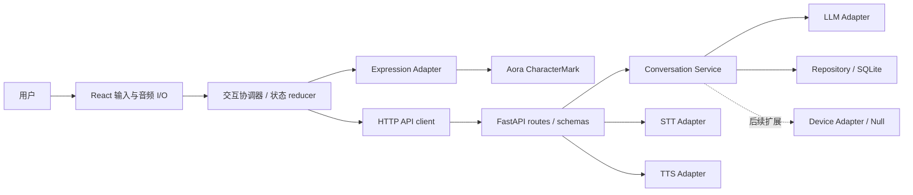

# 技术架构（V0 目标设计）

## 独立硬件 H1

新增 `firmware/` ESP-IDF 5.5.4 + LVGL 9.5.0 工程，仅针对 Waveshare ESP32-S3-Touch-LCD-1.85B。`main/face_model` 管理情绪、阶段、TTL、自然眨眼与插值；`face_view` 只把几何帧映射到 LVGL 图元；`components/nomi_panel` 使用该板官方 ST77916 QSPI 引脚、两版初始化表和部分 DMA 双缓冲。LVGL 与状态机只由主任务操作，串口命令在同一任务内消费，不存在跨任务直接修改界面。

H1 独立上电显示脸，不加载 React/Aora，不消费 HTTP emotion/motion，不连接后端，也不实现 Device Adapter 传输、音频/AI/记忆/舵机。阶段与情绪分离；有界本地串口仅供硬件测试，未知输入回退 idle。触摸暂不启用。网页与后端 API 契约没有变化。准确板型、版本证据及恢复流程见 [HARDWARE_H1](HARDWARE_H1.md)，构建/测试见 [firmware](../firmware/README.md)。软件验证不等于实体硬件通过。

状态：前端阶段 1 Mock、阶段 2A 后端与阶段 2B 开发 HTTP 集成已实现；全栈持久化、语音与硬件仍为目标设计。接口字段以 [API_CONTRACT](API_CONTRACT.md) 为准，阶段以 [ROADMAP](ROADMAP.md) 为准。

## 阶段 2B 已实现边界

App 配置 → 统一 ChatService → 前端 mockChat 或 HTTP Client → 同源 Vite /api Proxy → FastAPI /api/v0/chat。Provider 选择和 Key 留在后端；前端与后端 Mock 的身份分别显示。所有生产构建由构建期常量强制选择前端 Mock，不允许 URL 或本地存储切换；Pages 工作流不需要后端。

- services/chatService 定义统一结果，HTTP Client 将 reply 转为 text，校验枚举/UUID/长度，固定安全错误文案。API 根只允许同源 /api/...，代理目标只允许服务端配置的 loopback HTTP。后端 Host/Origin/CORS 没有放宽。
- 控制器持有独立 session_id 和操作身份，服务对象无会话全局状态；首轮无 ID，只有当前成功响应才写入。新会话 abort/清空旧 ID 并隔离迟到结果。
- pendingMessage 与成功消息分离，失败/取消移除临时项，成功成对追加到最近 60 条；idle 不清历史。SESSION_NOT_FOUND 需要用户主动新建，不静默重建或自动重发。
- 保留原有 ref 锁、AbortController、卸载清理、调试与错误恢复。网络/未知结果或停止等待明确提示后端未必停止；无幂等和收费模型自动重试。
- 真实 emotion 只经 Expression Adapter；speaking 仍为 2.4 秒无声展示。motion 仅作为消息描述与调试数据，无动作执行。
- contracts/chat-v0.json 与 Pydantic/前端类型双向测试；实际 HTTP 集成测试使用专用 FastAPI 进程 + 测试 Mock，无付费模型。前端与 Pages 回归单独验证。

本次没有修改 HTTP 契约、后端安全边界或 Pages 部署流程，没有公网服务。配置与启动/限制见 [INTEGRATION](INTEGRATION.md)。

## 阶段 2A 已实现边界

实际链路：FastAPI routes → ConversationService → MockProvider / OpenAIProvider → Pydantic StructuredReply。2A 最初独立交付；阶段 2B 经开发 HTTP Client 接入，Pages 仍仅 Mock。当前已实现协议见 API_CONTRACT；旧全栈草案归档为 design/API_V0_PLANNED。

- `backend/app/core/`：Pydantic Settings、固定错误码、loopback Host/精确 Origin、64 KiB 请求限制、request_id 和脱敏日志。
- `backend/app/domain/models.py`：ChatRequest / StructuredReply / ChatResponse / Health / ErrorEnvelope，emotion 与 motion 为枚举。
- `backend/app/adapters/llm/`：Provider Protocol、默认 Mock、HTTPX 非流式 Chat Completions。Base URL/Model/Key 显式配置；HTTPS、正常 TLS、无重定向/自动重试，不发送 tools/functions。
- `backend/app/services/conversation.py`：有界单进程内存上下文、完整历史对裁剪、并发占用与失败恢复。仅通过验证后追加历史；asyncio 总期限覆盖 Provider 调用和响应读取。
- `backend/app/api/` 与 `main.py`：当前只提供 `/api/v0/health`、`/api/v0/chat`，生命周期复用/关闭 HTTP client；`cli.py` 固定单 worker，本机启动。
- `backend/tests/`：pytest / pytest-asyncio / MockTransport，不依赖真实账号；独立 backend.yml 只检查后端，不修改 Pages。

本阶段**有意使用内存作为基本上下文**，未实现下文目标中的 SQLite、消息 CRUD、turn_id 幂等与跨进程恢复。默认最多 100 会话、1800 秒空闲时效、10 轮窗口（含本轮）、16000 码点总预算；失败/取消释放占用，已有成功历史不变，新匿名失败会话清除。进程重启丢失全部上下文，不支持多 worker。字符预算不是精确 token 预算。

模型输出必须严格为 reply/emotion/motion；非法结构或枚举返回 UPSTREAM_INVALID_RESPONSE。**2A 不采用后文原草案的 neutral 静默降级**。输出 motion 是 none/nod/tilt/bounce 的描述，不执行硬件或系统操作；后续 Device Adapter 即使加入，也必须独立验证与授权，不能直接消费自由模型指令。

前端的 phase/emotion 分离与 Mock 保留；2B 仅通过 Expression Adapter 将后端 emotion 转为 Aora 表情，motion 不当作 Aora state 或硬件命令。

后文“目标”包括尚未实现的全栈设计；当前实现以本节、API_CONTRACT 与 backend/README 为准。Python 3.12 + pyproject + 单一 uv.lock，具体版本由锁文件记录。

## 阶段 1 已实现边界

当前运行链路：App → useRobotController → 本地 mockChat → reducer → RobotView / ChatPanel；Expression Adapter 为唯一 Aora 状态映射。这是原始 Mock 路径，2B 另增显式 API 路径；仍没有语音或数据库。此次用户明确授权前端聊天外壳与 Mock 情绪展示，不视为提前实现真实 V0.2/V0.3。

- `frontend/src/app/`：页面装配、柔和响应式样式。
- `frontend/src/features/robot/`：领域类型、reducer、带 AbortController 的控制器、RobotView、DebugPanel。
- `frontend/src/features/conversation/`：输入与内存消息列表。
- `frontend/src/services/mockChat.ts`：确定性关键词预设、900ms 延迟、可取消等待与 `/error` 场景。
- `frontend/src/adapters/expression/`：唯一 Aora 映射；`shape="circle"`、cream、cute。`dot` 属角色标识而非 shape，不混用。
- 前端单元测试与组件测试就近放置；浏览器测试为 `frontend/tests/e2e/`，从 frontend 的 Playwright 配置运行，不创建空根 tests。

本阶段交互状态为 idle/listening/thinking/speaking/error；情绪为 neutral/happy/sad/curious/surprised/angry/concerned。angry 起初为本地预览扩展；阶段 2A 后端也接受该情绪，2B 已在开发 API 模式连接。

Mock 流程 idle → thinking → speaking + 情绪 → idle。speaking 仅是 2400ms 无声展示，情绪非 neutral 时显示对应原生表情，neutral 映射 humming；未来真实语音仍按后文工作态优先的目标协议设计，再明确迁移方案。listening 仅调试预览，不录音。预览也使用同一控制器锁，2400ms 到期恢复。

reducer 守卫非法顺序，ref 锁阻止同一事件周期重复提交；操作级 AbortController 与身份检查隔离迟到结果，卸载清理所有本地计时器。停止保留已有聊天，不自动补发请求。错误后必须恢复待机再发送。消息仅内存保留最近 60 条，不使用 localStorage 或 SQLite。

Aora `autoPause=true` 负责离屏、隐藏与 prefers-reduced-motion 动画暂停，CSS 同时关闭自有脉冲动画；工作状态另有文字。原生浏览器测试验证真实 SVG 挂载及待机帧变化。

前端使用严格 TypeScript、npm 精确版本与 package-lock；Node 基线 22.22.2+ / 24.15.0+，这是 jsdom 31 等锁定工具要求。本次实际验证 Node 24.22.1，Node 22 尚未单独实测。阶段 2A 后端已另有 pyproject / uv.lock。

## 阶段 1 静态在线预览

GitHub Pages 仅托管 `frontend/dist/` 的现有 Mock 原型。Vite base 为 `/Desktop-NOMI/`；单页入口无业务路由，不增加 SPA fallback 或后端。Actions 在 PR 中执行检查，仅 main 非 PR 运行具备部署路径。完整设置、权限及真实公网验证限制见 [PREVIEW](PREVIEW.md)。本地 Node 静态测试服务器只是浏览器测试 fixture，不构成业务服务。

## 边界与依赖方向

Windows 浏览器运行 React，FastAPI 在同一电脑运行。V0 不选 Electron / Tauri，不承诺置顶、托盘、透明窗口或安装包；在浏览器验证交互后另作 ADR。开发 Vite 5173、后端 8000；正式本机分发方式留待后续决策，后端不开放公网；当前 Mock 前端可通过 GitHub Pages 独立公开预览。



领域服务不依赖 FastAPI Request 或 Aora 类型。API 层负责协议校验；Provider Adapter 负责外部 SDK 与超时转换；Repository 负责存储。前端业务状态由 React reducer/context 管理，暂不引入全局状态库。

## 目录规划

下列为完整目标布局；实际已实现的前端目录见上节，剩余目录在相应阶段创建。

```text
frontend/
  src/app/                 应用装配、入口和配置
  src/features/robot/      RobotView、交互状态 reducer
  src/features/conversation/ 输入与消息展示（V0.2）
  src/adapters/expression/ Aora 映射及降级
  src/adapters/audio/      录音、播放、设备权限（V0.4）
  src/api/                HTTP client 与契约类型
backend/
  app/main.py             FastAPI 装配
  app/api/                routes、请求与响应 schemas
  app/core/               配置、错误、日志
  app/domain/             领域对象、情绪规则
  app/services/           会话编排
  app/adapters/llm/        OpenAI 兼容调用
  app/adapters/stt/        语音识别接口与实现（V0.4）
  app/adapters/tts/        语音合成接口与实现（V0.4）
  app/adapters/device/     Null / Mock 接口（V0.5）
  app/storage/            SQLite repository、迁移
  tests/                  pytest 单元与适配器测试
frontend/src/**/*.test.*   Vitest 单元与组件测试
tests/contract/            跨端契约测试（根目录 tests，下同）
tests/e2e/                 端到端与 Windows 验收记录
```

前端使用 npm + package-lock；后端已使用 pyproject + uv.lock。不得同时引入多套锁文件。Python 3.12 为后端基线，Node 前端要求见上节，需在 Windows 与 CI 中落实版本约束。

## 模块职责

| 模块 | 职责和约束 |
| --- | --- |
| RobotCoordinator | 管理 turn、取消与 UI 状态；不调用供应商 SDK |
| ExpressionAdapter | 输入领域情绪及工作状态，输出 Aora CharacterState；处理 TTL、降级和 reduced-motion |
| API client | URL、超时、错误归一化、request_id；不持有供应商 Key |
| ConversationService | 会话所有权校验、串行 turn、上下文裁剪、LLM 调用、提交消息与情绪 |
| LLMAdapter | 2A 为 `complete(messages) -> raw JSON`；服务层严格校验 reply/emotion/motion。兼容非流式 Chat Completions，JSON mode 可选，不假设供应商支持 JSON schema |
| STTAdapter | `transcribe(audio_bytes, mime_type, language?) -> {text, language?}`；具体供应商待 V0.4 决定 |
| TTSAdapter | `synthesize(text, voice?, language?) -> {audio_bytes, mime_type}`；具体供应商待 V0.4 决定 |
| Repository | SQLite 单机数据访问、事务、迁移与删除 |
| DeviceAdapter | 未来 `capabilities / apply_expression / stop / close`；V0 Null 无副作用、Mock 仅记录测试事件 |

STT / TTS 关闭时返回结构化 `FEATURE_DISABLED`，不能假装成功。浏览器 Web Speech API 可作为后续替代方案评估，不作为跨浏览器默认依赖。

## 全栈目标数据流（当前链路见阶段 2A）

文字：创建会话 → 前端生成 turn_id → POST 消息并进入 thinking → 后端加载最近 20 条成功消息（另按模型可配置上下文预算裁剪）→ LLM → 校验文本与情绪 → 事务保存 user/assistant 消息及结果 → 返回 → 前端展示并应用短时情绪 → idle。用户输入不当作系统指令；模型输出不直接触发设备或执行命令。

V0 使用非流式 HTTP，不引入 WebSocket / SSE。后续流式必须增加契约版本或兼容字段，并设计断线、序号和终态。

语音（V0.4）：点击录音 → listening → 停止录音后 transcribing → STT 文本 → 与文字共用 turn 流程 → 可选 synthesizing → TTS 音频 → 浏览器实际播放后 speaking → 播放结束 idle。拒绝权限或播放失败时保留文字操作与结果，不自动循环录音。

## 工作状态机

状态归前端协调器所有，后端健康与消息结果是输入事件；业务错误不要由动画完成回调决定。

| 当前状态 | 事件 | 下一状态 |
| --- | --- | --- |
| idle | 提交文字 / 开始录音 | thinking / listening |
| listening | 停止录音 / 取消 | transcribing / idle |
| transcribing | 识别非空 / 空文本 | thinking / idle |
| thinking | 回复成功且启用语音 / 无语音 | synthesizing / idle |
| synthesizing | 音频返回 | 保持，直到播放开始后 speaking |
| speaking | ended / 停止 | idle |
| 任意忙碌状态 | 取消 | idle，销毁本地录音和音频引用 |
| 任意状态 | 不可恢复的本轮错误 | error |
| error | 确认 / 重试 | idle / 对应操作起点 |

本轮生成前端 epoch，取消后递增；丢弃旧 epoch 的 HTTP 与音频回调，避免旧回复抢占新表情。取消中止本地 fetch，不保证供应商停止计费；后端可完成并保存结果，使用 turn_id 查询重试的结果。V0 每个会话最多一个在途 turn，冲突返回 409。前端不自动重试可能计费的失败请求。

## 前端与全栈目标情绪协议（不替代阶段 2A 严格校验）

阶段 2A 与前端的情绪值均覆盖 `neutral | happy | sad | curious | surprised | angry | concerned`，当前 HTTP 结构见契约。情绪与工作状态正交，避免把 thinking 当成人格情绪。2A 对非法/缺失结构严格报错；未来若增加强度、TTL 等情绪元数据，应另行设计降级策略，不与当前格式错误处理混用。

ExpressionAdapter 唯一管理 Aora：优先级为 error → 忙碌工作状态 → 未过期情绪 → idle。error 映射 confused；listening 映射 listening；transcribing / thinking / synthesizing 映射 thinking；speaking 映射 humming（上游没有 speaking 状态，不声称精准口型）。neutral→idle、happy→happy、sad→sad、curious→curious、surprised→surprised、concerned→confused。强度 V0 仅保留语义元数据，不假设 Aora 支持同名参数。

TTL 从前端收到结果的单调时钟开始，工作态可覆盖显示但不会延长 TTL；过期恢复 idle。新 turn 清除上一轮情绪。不要同时给 CharacterMark 传 state 与 emotionId：上游 state 优先。本项目 HTTP 不暴露上游数字 emotionId，未来升级只修改 Adapter。启用 reduced-motion 并为状态提供文字说明，动画不可作为唯一错误提示。

## 全栈本地数据与配置目标（SQLite 未实现）

SQLite 位于 `NOMI_DATA_DIR`，默认根目录 `.local/nomi`，被 Git 忽略。表规划 sessions(id, created_at)、messages(id, session_id, turn_id, role, text, created_at)、turns(session_id, turn_id, request_hash, status, response_json, created_at)；成功结果与两条消息同事务提交，唯一键 `(session_id, turn_id)`。pending 可独立持久化以防重复计费；重启后 pending 标记 interrupted，返回 TURN_INTERRUPTED，不自动再请求供应商。失败消息不加入上下文；同 ID 的确定失败结果可查询，重试需新 ID。

默认会话按 30 天清理，单次消息上限见契约，用户可删除整个会话及关联 turn；敏感数据不写日志。语音只在内存处理，默认不持久化；后续长期记忆需独立用户授权、清除和导出策略。SQLite 未默认加密，依赖本机账户权限，不承诺防御同机恶意进程。

配置仅后端加载根 `.env` 并由进程环境覆盖；模型、Base URL、Key 都无内置真实值。Base URL 必须显式提供完整 API 根（如含供应商要求的 /v1），Adapter 不擅自重复追加 /v1。Key 不存数据库、不返回 API。未来非敏感设置 UI 必须独立设计，不开放任意 URL / Key 写入接口。

开发仅精确允许 `http://localhost:5173` 与 `http://127.0.0.1:5173`，禁用 credentials 和通配来源，校验 Host 并拒绝未知 Origin；写请求要求 JSON / 特定音频 content type。无用户登录只适用于 loopback 原型；开放 LAN / 打包前另行设计认证和本地调用保护。LLM 60 秒、STT / TTS 30 秒超时；前端对应 65 / 35 秒。日志只记录 request_id、错误码与耗时。

## 未来硬件扩展

未来 Device Adapter 消费已校验的领域情绪和状态，不能直接接收 LLM 自由文本命令。适配器通过能力协商区分屏幕、音频、舵机，V0 不决定串口 / WebSocket / MQTT 传输，也不假设 ESP32 可以运行 React / SVG。硬件版本需独立渲染映射、连接认证、序号、ACK、重试上限、舵机角度/速度限幅和断线停止；真实硬件命令与公共 HTTP API 暂不设计或实现。
