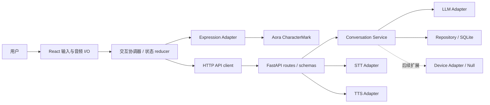

# 技术架构（V0 目标设计）

状态：设计基线，所有模块尚未实现。接口字段以 [API_CONTRACT](API_CONTRACT.md) 为准，阶段以 [ROADMAP](ROADMAP.md) 为准。

## 边界与依赖方向

Windows 浏览器运行 React，FastAPI 在同一电脑运行。V0 不选 Electron / Tauri，不承诺置顶、托盘、透明窗口或安装包；在浏览器验证交互后另作 ADR。开发 Vite 5173、后端 8000；正式本机分发如何托管静态资源留待后续决策，不开放公网。



领域服务不依赖 FastAPI Request 或 Aora 类型。API 层负责协议校验；Provider Adapter 负责外部 SDK 与超时转换；Repository 负责存储。前端业务状态由 React reducer/context 管理，暂不引入全局状态库。

## 目录规划

下列目录在相应阶段创建；当前只保留文档与配置示例。

```text
frontend/
  src/app/                 应用装配、入口和配置
  src/features/robot/      RobotView、交互状态 reducer
  src/features/conversation/ 输入与消息展示（V0.2）
  src/adapters/expression/ Aora 映射及降级
  src/adapters/audio/      录音、播放、设备权限（V0.4）
  src/api/                HTTP client 与契约类型
backend/
  app/main.py             FastAPI 装配
  app/api/                routes、请求与响应 schemas
  app/core/               配置、错误、日志
  app/domain/             领域对象、情绪规则
  app/services/           会话编排
  app/adapters/llm/        OpenAI 兼容调用
  app/adapters/stt/        语音识别接口与实现（V0.4）
  app/adapters/tts/        语音合成接口与实现（V0.4）
  app/adapters/device/     Null / Mock 接口（V0.5）
  app/storage/            SQLite repository、迁移
  tests/                  pytest 单元与适配器测试
frontend/src/**/*.test.*   Vitest 单元与组件测试
tests/contract/            跨端契约测试（根目录 tests，下同）
tests/e2e/                 端到端与 Windows 验收记录
```

依赖与锁文件到 V0.1 才添加：npm + package-lock，Python 使用标准 pyproject 并选择一种锁定方式。不得同时引入多套锁文件。Python 3.12 / Node 22 LTS 为计划基线，需在 Windows 与 CI 中落实版本约束。

## 模块职责

| 模块 | 职责和约束 |
| --- | --- |
| RobotCoordinator | 管理 turn、取消与 UI 状态；不调用供应商 SDK |
| ExpressionAdapter | 输入领域情绪及工作状态，输出 Aora CharacterState；处理 TTL、降级和 reduced-motion |
| API client | URL、超时、错误归一化、request_id；不持有供应商 Key |
| ConversationService | 会话所有权校验、串行 turn、上下文裁剪、LLM 调用、提交消息与情绪 |
| LLMAdapter | `generate(messages, timeout) -> {text, emotion?}`；支持 OpenAI 兼容 Chat Completions，不假设供应商支持流式或 JSON schema |
| STTAdapter | `transcribe(audio_bytes, mime_type, language?) -> {text, language?}`；具体供应商待 V0.4 决定 |
| TTSAdapter | `synthesize(text, voice?, language?) -> {audio_bytes, mime_type}`；具体供应商待 V0.4 决定 |
| Repository | SQLite 单机数据访问、事务、迁移与删除 |
| DeviceAdapter | 未来 `capabilities / apply_expression / stop / close`；V0 Null 无副作用、Mock 仅记录测试事件 |

STT / TTS 关闭时返回结构化 `FEATURE_DISABLED`，不能假装成功。浏览器 Web Speech API 可作为后续替代方案评估，不作为跨浏览器默认依赖。

## 数据流

文字：创建会话 → 前端生成 turn_id → POST 消息并进入 thinking → 后端加载最近 20 条成功消息（另按模型可配置上下文预算裁剪）→ LLM → 校验文本与情绪 → 事务保存 user/assistant 消息及结果 → 返回 → 前端展示并应用短时情绪 → idle。用户输入不当作系统指令；模型输出不直接触发设备或执行命令。

V0 使用非流式 HTTP，不引入 WebSocket / SSE。后续流式必须增加契约版本或兼容字段，并设计断线、序号和终态。

语音（V0.4）：点击录音 → listening → 停止录音后 transcribing → STT 文本 → 与文字共用 turn 流程 → 可选 synthesizing → TTS 音频 → 浏览器实际播放后 speaking → 播放结束 idle。拒绝权限或播放失败时保留文字操作与结果，不自动循环录音。

## 工作状态机

状态归前端协调器所有，后端健康与消息结果是输入事件；业务错误不要由动画完成回调决定。

| 当前状态 | 事件 | 下一状态 |
| --- | --- | --- |
| idle | 提交文字 / 开始录音 | thinking / listening |
| listening | 停止录音 / 取消 | transcribing / idle |
| transcribing | 识别非空 / 空文本 | thinking / idle |
| thinking | 回复成功且启用语音 / 无语音 | synthesizing / idle |
| synthesizing | 音频返回 | 保持，直到播放开始后 speaking |
| speaking | ended / 停止 | idle |
| 任意忙碌状态 | 取消 | idle，销毁本地录音和音频引用 |
| 任意状态 | 不可恢复的本轮错误 | error |
| error | 确认 / 重试 | idle / 对应操作起点 |

本轮生成前端 epoch，取消后递增；丢弃旧 epoch 的 HTTP 与音频回调，避免旧回复抢占新表情。取消中止本地 fetch，不保证供应商停止计费；后端可完成并保存结果，使用 turn_id 查询重试的结果。V0 每个会话最多一个在途 turn，冲突返回 409。前端不自动重试可能计费的失败请求。

## 情绪协议与表情仲裁

领域情绪采用 `neutral | happy | sad | curious | surprised | concerned`，结构、范围见契约。与工作状态正交，避免把 thinking 当成人格情绪。后端返回已验证 emotion；模型仅提供候选，非法、缺失或不支持结构化输出时回退 neutral，不影响有效回复。

ExpressionAdapter 唯一管理 Aora：优先级为 error → 忙碌工作状态 → 未过期情绪 → idle。error 映射 confused；listening 映射 listening；transcribing / thinking / synthesizing 映射 thinking；speaking 映射 humming（上游没有 speaking 状态，不声称精准口型）。neutral→idle、happy→happy、sad→sad、curious→curious、surprised→surprised、concerned→confused。强度 V0 仅保留语义元数据，不假设 Aora 支持同名参数。

TTL 从前端收到结果的单调时钟开始，工作态可覆盖显示但不会延长 TTL；过期恢复 idle。新 turn 清除上一轮情绪。不要同时给 CharacterMark 传 state 与 emotionId：上游 state 优先。本项目 HTTP 不暴露上游数字 emotionId，未来升级只修改 Adapter。启用 reduced-motion 并为状态提供文字说明，动画不可作为唯一错误提示。

## 本地数据与配置

SQLite 位于 `NOMI_DATA_DIR`，默认根目录 `.local/nomi`，被 Git 忽略。表规划 sessions(id, created_at)、messages(id, session_id, turn_id, role, text, created_at)、turns(session_id, turn_id, request_hash, status, response_json, created_at)；成功结果与两条消息同事务提交，唯一键 `(session_id, turn_id)`。pending 可独立持久化以防重复计费；重启后 pending 标记 interrupted，返回 TURN_INTERRUPTED，不自动再请求供应商。失败消息不加入上下文；同 ID 的确定失败结果可查询，重试需新 ID。

默认会话按 30 天清理，单次消息上限见契约，用户可删除整个会话及关联 turn；敏感数据不写日志。语音只在内存处理，默认不持久化；后续长期记忆需独立用户授权、清除和导出策略。SQLite 未默认加密，依赖本机账户权限，不承诺防御同机恶意进程。

配置仅后端加载根 `.env` 并由进程环境覆盖；模型、Base URL、Key 都无内置真实值。Base URL 必须显式提供完整 API 根（如含供应商要求的 /v1），Adapter 不擅自重复追加 /v1。Key 不存数据库、不返回 API。未来非敏感设置 UI 必须独立设计，不开放任意 URL / Key 写入接口。

开发仅精确允许 `http://localhost:5173` 与 `http://127.0.0.1:5173`，禁用 credentials 和通配来源，校验 Host 并拒绝未知 Origin；写请求要求 JSON / 特定音频 content type。无用户登录只适用于 loopback 原型；开放 LAN / 打包前另行设计认证和本地调用保护。LLM 60 秒、STT / TTS 30 秒超时；前端对应 65 / 35 秒。日志只记录 request_id、错误码与耗时。

## 未来硬件扩展

未来 Device Adapter 消费已校验的领域情绪和状态，不能直接接收 LLM 自由文本命令。适配器通过能力协商区分屏幕、音频、舵机，V0 不决定串口 / WebSocket / MQTT 传输，也不假设 ESP32 可以运行 React / SVG。硬件版本需独立渲染映射、连接认证、序号、ACK、重试上限、舵机角度/速度限幅和断线停止；真实硬件命令与公共 HTTP API 暂不设计或实现。
